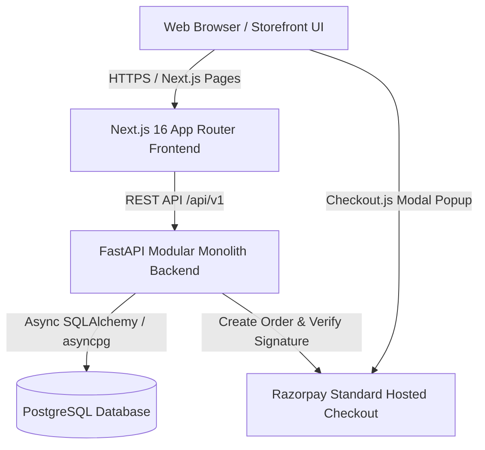

# Ember & Co. — LighterShopDemo

> A modern luxury e-commerce platform for handcrafted and precision-machined pocket lighters, built for **Retail** and **Wholesale (B2B)** commerce with official **Razorpay Standard Checkout** payment integration.

---

## ✦ System Architecture



---

## 🛠 Tech Stack

| Layer | Technology | Description |
| :--- | :--- | :--- |
| **Frontend** | **Next.js 16** (App Router, TypeScript) | Server & Client components, responsive layout, fluid CSS animations, dynamic retail/wholesale store mode switcher, and live bag drawer. |
| **Backend** | **FastAPI** (Python 3.12) | High-performance async modular monolith with services for catalog, pricing, inventory locking, orders, and payments. |
| **Database** | **PostgreSQL** | Relational storage for products, tiered wholesale price breaks, orders, transactions, and inventory audit logs. |
| **Payments** | **Razorpay Standard Checkout** | Server-side Razorpay order generation and HMAC-SHA256 signature verification. Application never stores customer card numbers or CVVs. |
| **Tooling** | **uv** & **npm** | Ultra-fast dependency resolution and virtual environments. |

---

## 📁 Repository Structure

```
LighterShopDemo/
├── frontend/
│   ├── src/
│   │   ├── app/
│   │   │   ├── layout.tsx         # Root layout with Auth & Cart providers
│   │   │   ├── globals.css        # Editorial design tokens & animations
│   │   │   ├── page.tsx           # Storefront hero & catalog
│   │   │   ├── checkout/          # Razorpay checkout & GST invoice form
│   │   │   │   ├── page.tsx
│   │   │   │   └── success/       # Order confirmation & confetti receipt
│   │   │   ├── account/           # Customer portal & wholesale registration
│   │   │   └── admin/             # Operations dashboard & restock manager
│   │   ├── components/            # UI components (Hero, Grid, Card, Drawer, Modal)
│   │   ├── features/              # Cart & Auth state machines
│   │   ├── lib/                   # API client, formatters, Razorpay loader
│   │   └── types/                 # TypeScript interfaces
│   ├── public/
│   │   └── images/                # Studio packshots of lighters
│   └── Dockerfile
│
├── backend/
│   ├── app/
│   │   ├── api/v1/                # REST endpoints (auth, products, pricing, orders, payments, admin)
│   │   ├── core/                  # Database engine, config, security, initial seed data
│   │   ├── models/                # SQLAlchemy 2.0 async models
│   │   ├── schemas/               # Pydantic v2 schemas
│   │   ├── repositories/          # Data access layer
│   │   ├── services/
│   │   │   ├── catalog/           # Product and category discovery
│   │   │   ├── pricing/           # Dual-mode retail & tiered wholesale calculation
│   │   │   ├── inventory/         # Atomic stock locking & audit logs
│   │   │   ├── orders/            # Order creation with server-side validation
│   │   │   └── payments/          # Razorpay order creation & signature verification
│   │   └── main.py                # FastAPI entry point & CORS
│   ├── tests/                     # Integration test suite (pytest)
│   ├── pyproject.toml
│   └── Dockerfile
│
├── infrastructure/
│   ├── docker/                    # docker-compose.yml & nginx.conf
│   ├── deployment/                # Automated deploy script
│   └── monitoring/                # Service healthcheck script
│
├── .github/workflows/ci.yml       # Automated CI workflow
├── .env.example                   # Environment variable template
├── .gitignore
└── README.md
```

---

## ⚡ Quick Start Guide

### 1. Configure Environment Variables

Provide your PostgreSQL database connection string and Razorpay credentials in `.env`:

```bash
cp .env.example .env
```

Edit `.env`:
```ini
# PostgreSQL connection string
DATABASE_URL=postgresql+asyncpg://<username>:<password>@<host>:5432/<database_name>

# Razorpay credentials (get from https://dashboard.razorpay.com/app/keys)
RAZORPAY_KEY_ID=rzp_test_YOUR_KEY_ID
RAZORPAY_KEY_SECRET=YOUR_KEY_SECRET
```

> **Note:** If `DATABASE_URL` is empty or PostgreSQL is not reachable, the system automatically falls back to local async SQLite (`sqlite+aiosqlite:///./lightershop.db`) so the application starts and can be tested without any friction!

---

### 2. Run Backend (FastAPI)

```bash
cd backend
source .venv/bin/activate    # or create venv: uv venv && source .venv/bin/activate
uv pip install .
uvicorn app.main:app --host 0.0.0.0 --port 8000 --reload
```

- **API Documentation (Swagger UI)**: [http://localhost:8000/docs](http://localhost:8000/docs)
- **API Health Check**: [http://localhost:8000/health](http://localhost:8000/health)

---

### 3. Run Frontend (Next.js)

```bash
cd frontend
npm install
npm run dev
```

- **Storefront**: [http://localhost:3000](http://localhost:3000)
- **Admin Operations**: [http://localhost:3000/admin](http://localhost:3000/admin)
- **Account & Wholesale Portal**: [http://localhost:3000/account](http://localhost:3000/account)

---

### 4. Run via Docker Compose

```bash
docker compose -f infrastructure/docker/docker-compose.yml up --build -d
```

---

## 💎 Features & Capabilities

### 🛍 Retail Mode
- Curated luxury pocket lighters: **Classic Steel**, **Midnight Black**, **Heritage Gold**, **Crimson Edition**, **Pocket Essential**, and **Signature Black**.
- Single-item purchases with transparent GST (18%) and free shipping for orders over ₹1,999.
- Interactive slide-over cart drawer with live volume savings progress bar.

### 🏭 Wholesale (B2B) Mode
- **Minimum Order Quantities (MOQ)** enforced per item (e.g. 20 pcs for Classic Steel).
- **Volume Tiers**: Starter Pack, Master Carton, and Distributor Pallet with up to 45% margin discounts.
- **GST Tax Invoice Support**: Buyer inputs registered business name and 15-digit GSTIN at checkout to claim Input Tax Credit (ITC).
- **Wholesale Verification Portal**: Instant business registration and admin approval workflow.

### 💳 Razorpay Standard Checkout
- Fully compliant server-to-server order generation.
- Client-side checkout modal popup loaded via `https://checkout.razorpay.com/v1/checkout.js`.
- Strict HMAC-SHA256 signature verification upon completion.
- Built-in demonstration fallback for seamless offline or client evaluation.

### 📊 Merchant Admin Dashboard
- Live revenue analytics and sales split (Retail vs Wholesale).
- Low inventory alerts with atomic restock replenishment tool.
- Wholesale application review system (one-click Approve / Reject).
- Order fulfillment lifecycle tracker.

---

## 🧪 Testing

Run backend automated test suite:
```bash
cd backend
.venv/bin/pytest -v
```
All integration tests run against database transactions, quote calculators, order creations, and Razorpay signature verifications.
